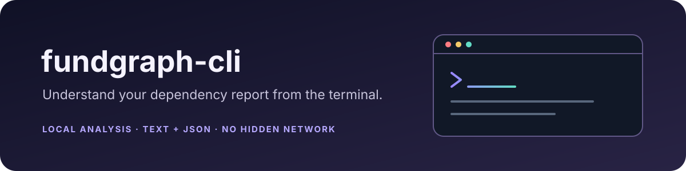

# fundgraph-cli

<p align="center"></p>

<p align="center">
  <a href="https://github.com/FundGraph/fundgraph-cli/actions/workflows/ci.yml"></a>
  <a href="LICENSE"></a>
  
  
</p>

The command-line interface for reviewing dependency funding evidence in deterministic text or JSON reports. It uses
`@fundgraph/core` for discovery, provenance, and analysis; it does not duplicate domain logic.

## Repository role

`fundgraph-cli` owns the `fundgraph` executable: command parsing, filesystem input, output rendering, exit codes,
packaging, and CLI integration tests. The reusable models, evidence logic, and report semantics remain in
[`fundgraph-core`](https://github.com/FundGraph/fundgraph-core).

```mermaid
flowchart LR
  A[Project directory or JSON input] --> B[CLI parsing and boundaries]
  B --> C[@fundgraph/core analysis]
  C --> D[Deterministic text or JSON report]
  D --> E[Exit code]
```

## Current scope

`fundgraph analyze` reads a supported project directory, a JSON model file, or JSON from stdin. Directory discovery is
the input boundary for npm, PyPI, Cargo, and baseline Go `go.mod` requirements. The default directory mode is local-only.
Add `--network` to explicitly fetch public npm, PyPI, or crates.io metadata and produce the evidence-backed funding
report. Go remains discovery-only because Go metadata and funding providers are not implemented.

The CLI now orchestrates those stages for arbitrary npm, PyPI, and Cargo projects when `--network` is explicitly
supplied. Registry and funding responses are point-in-time observations and may become stale; the report preserves their
observation timestamps. Default directory analysis remains local-only; Go is discovery-only.

## Commands

```text
fundgraph --help
fundgraph version
fundgraph analyze [PATH] [--format text|json] [--offline|--network] [--strict]
```

`PATH` defaults to the current directory. Use `-` or omit the path to read JSON from stdin. `--offline` makes the local
only behavior explicit. `--strict` treats invalid model input as an error.

| Exit code | Meaning |
|---:|---|
| `0` | Analysis completed without diagnostics |
| `1` | Partial analysis or model diagnostics |
| `2` | Usage or invalid input |
| `3` | Unexpected internal failure |

JSON output keeps the compatibility summary fields and includes the versioned core report under `report`. Text output
prints the summary and deterministic report. `--network` is opt-in and uses the core network policy.

## Try it from the workspace

For normal use, install the published CLI package:

```sh
npm install -g fundgraph@0.1.2
fundgraph --version
fundgraph analyze ./my-project --format text --offline
```

For repository development, run these commands from the `fundgraph-cli` repository directory:

```sh
cd ../fundgraph-core
npm ci
npm run build

cd ../fundgraph-cli
npm install --ignore-scripts --no-save ../fundgraph-core
npm run build
node dist/main.js --help
node dist/main.js analyze ../fundgraph-core/test/fixtures/npm-workspace --format text --offline
node dist/main.js analyze ../fundgraph-core/test/fixtures/npm-workspace --format json --offline
node dist/main.js analyze ./my-project --format json --network
```

## Ownership and safety

- This repository owns argument parsing, terminal output, CLI errors, and process exit codes.
- `fundgraph-core` owns dependency models, parsing, evidence, relationship logic, and opt-in project orchestration.
- Input files are bounded and treated as data; the CLI does not execute project code.
- The command does not identify maintainers, endorse funding destinations, manage wallets, or execute payments.

## Development

```sh
npm run lint
npm run typecheck
npm test
npm run build
npm pack --dry-run
```

CI defines Ubuntu, Windows, and macOS jobs on Node 20 and 22. See [`CONTRIBUTING.md`](CONTRIBUTING.md) and the
project-level `fundgraph` repository for the cross-repository roadmap and policies.

## Related repositories and governance

- [`fundgraph`](https://github.com/FundGraph/fundgraph) — project source of truth, roadmap, and release coordination.
- [`fundgraph-core`](https://github.com/FundGraph/fundgraph-core) — reusable discovery, evidence, and report library.
- [`SECURITY.md`](SECURITY.md) — security boundaries and reporting.
- [`CODE_OF_CONDUCT.md`](CODE_OF_CONDUCT.md) — community standards.
- [`CHANGELOG.md`](CHANGELOG.md) — release and change history.
